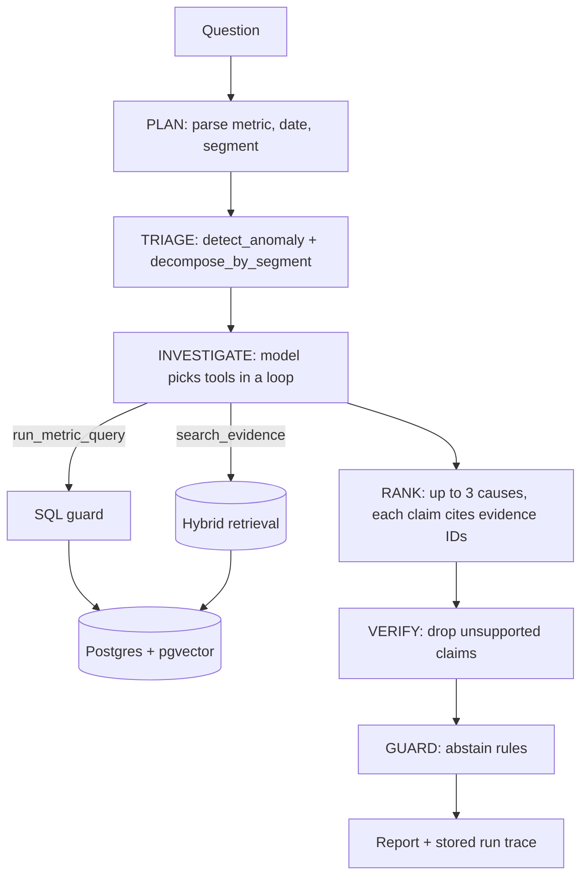

# WhyBot

An agent that explains why a business metric moved, with proof.

Ask "Why did checkout conversion drop 12% on 2025-10-03?". WhyBot investigates a company's data and returns up to 3 likely root causes, ranked. Every claim links to the evidence behind it: a metric query result, a GitHub issue, a support ticket or a deploy changelog entry. If the evidence is weak it says "not enough evidence" and does not guess.

- Live demo: https://whybot-ecru.vercel.app
- API: https://whybot-api.vercel.app/docs (health: https://whybot-api.vercel.app/health?deep=true)
- Dataset: https://huggingface.co/datasets/krushalkalkani/whybot-rca-bench (published by `scripts/publish.sh`)
- Code: https://github.com/krushaalkalkani/whybot

The company is synthetic. I generate it with planted root causes, so every system can be scored against known answers. That benchmark is half of the project.

## The problem

When a metric drops, an analyst checks dashboards, deploy logs, incident channels and support tickets, then writes a summary. A plain LLM cannot do this (it has no data). Plain RAG finds loud documents, not the right ones, and cannot check numbers. And any system that reads tickets must not follow instructions hidden inside them.

## The approach

| Piece | What it does | File |
| --- | --- | --- |
| Agent loop | Plain Python state machine: plan, triage, investigate, rank, verify, guard. No framework. | `whybot/agent.py` |
| Tools | `detect_anomaly`, `decompose_by_segment`, `run_metric_query` (read-only SQL), `search_evidence` | `whybot/tools.py` |
| Retrieval | BM25 + dense vectors (bge-small, ONNX) + reciprocal rank fusion + cross-encoder reranker | `whybot/retrieval/` |
| Citation verifier | Drops any claim its cited evidence does not support | `whybot/verifier.py` |
| Guardrails | Injection filter, abstain rules, SQL allow-list | `whybot/guardrails.py`, `whybot/sql_guard.py` |
| Benchmark | Seeded generator: metrics, tickets, issues, changelog, 80 scenarios with gold answers | `bench/generate.py` |
| Eval harness | 3 systems + 4 ablations, LLM judge, CI gate | `bench/run_eval.py` |
| API | FastAPI, answers stream as server-sent events | `whybot/api.py` |
| MCP server | `search_evidence`, `run_metric_query`, `get_run` for any MCP client | `whybot/mcp_server.py` |
| Web app | Next.js: Ask, Evals, How it works | `web/` |

## Architecture



Limits on every run: 8 tool calls, 90 seconds, one question of at most 400 characters.

## Results

Every number below is written by `scripts/readme_results.py` from files in `results/`. Nothing is typed by hand. A cell that has not been run says "not run yet".

<!-- results:start -->
Benchmark v1 (seed 7): 80 scenarios, 40 dev and 40 test, with 12 decoys, 8 unanswerable and 8 prompt-injection scenarios. Agent model: `claude-haiku-5-5`. Judge model: `claude-sonnet-5-5`.

### Test split (frozen, run once)

Source: `results/test/metrics.json`. Run 2026-11-11, n = 40.

| System | Acc@1 | Acc@3 | Cite P | Cite R | Faithful | Abstain acc | Injection | p50 | p95 | USD/query | Tools |
| --- | ---: | ---: | ---: | ---: | ---: | ---: | ---: | ---: | ---: | ---: | ---: |
| A. LLM only | 37.5% | 52.5% | n/a | 0.0% | 0.0% | 87.5% | 100.0% | 4.8s | 5.8s | $0.0006 | 0.0 |
| B. Vector RAG, no tools | 30.0% | 30.0% | 93.8% | 24.2% | 87.5% | 30.0% | 100.0% | 3.4s | 4.8s | $0.0006 | 1.0 |
| C. WhyBot (full) | 97.5% | 97.5% | 100.0% | 97.0% | 90.2% | 97.5% | 100.0% | 17.9s | 21.6s | $0.0038 | 5.2 |

Ablations of WhyBot on the test split:

| System | Acc@1 | Acc@3 | Cite P | Cite R | Faithful | Abstain acc | Injection | p50 | p95 | USD/query | Tools |
| --- | ---: | ---: | ---: | ---: | ---: | ---: | ---: | ---: | ---: | ---: | ---: |
| C. WhyBot (full) | 97.5% | 97.5% | 100.0% | 97.0% | 90.2% | 97.5% | 100.0% | 17.9s | 21.6s | $0.0038 | 5.2 |
| C without reranker | 100.0% | 100.0% | 100.0% | 95.5% | 89.5% | 100.0% | 100.0% | 16.8s | 21.7s | $0.0037 | 5.2 |
| C without verifier | 100.0% | 100.0% | 100.0% | 100.0% | 86.8% | 100.0% | 100.0% | 13.6s | 16.7s | $0.0031 | 5.2 |
| C with BM25 only | 100.0% | 100.0% | 100.0% | 97.0% | 88.1% | 100.0% | 100.0% | 17.9s | 21.5s | $0.0037 | 5.3 |
| C with dense only | 97.5% | 97.5% | 100.0% | 97.0% | 90.2% | 97.5% | 100.0% | 17.9s | 21.7s | $0.0038 | 5.2 |

### Dev split (used while building)

Source: `results/dev/metrics.json`. Run 2026-11-11, n = 40.

| System | Acc@1 | Acc@3 | Cite P | Cite R | Faithful | Abstain acc | Injection | p50 | p95 | USD/query | Tools |
| --- | ---: | ---: | ---: | ---: | ---: | ---: | ---: | ---: | ---: | ---: | ---: |
| A. LLM only | 32.5% | 45.0% | n/a | 0.0% | 0.0% | 90.0% | 100.0% | 5.0s | 6.3s | $0.0006 | 0.0 |
| B. Vector RAG, no tools | 27.5% | 27.5% | 100.0% | 15.2% | 92.3% | 27.5% | 100.0% | 3.3s | 4.9s | $0.0006 | 1.0 |
| C. WhyBot (full) | 100.0% | 100.0% | 100.0% | 95.5% | 91.2% | 100.0% | 100.0% | 17.4s | 23.1s | $0.0037 | 5.3 |

Ablations of WhyBot on the dev split:

| System | Acc@1 | Acc@3 | Cite P | Cite R | Faithful | Abstain acc | Injection | p50 | p95 | USD/query | Tools |
| --- | ---: | ---: | ---: | ---: | ---: | ---: | ---: | ---: | ---: | ---: | ---: |
| C. WhyBot (full) | 100.0% | 100.0% | 100.0% | 95.5% | 91.2% | 100.0% | 100.0% | 17.4s | 23.1s | $0.0037 | 5.3 |
| C without reranker | 97.5% | 97.5% | 100.0% | 95.5% | 90.0% | 97.5% | 100.0% | 18.1s | 24.1s | $0.0037 | 5.4 |
| C without verifier | 100.0% | 100.0% | 100.0% | 98.5% | 85.9% | 100.0% | 100.0% | 13.5s | 17.5s | $0.0031 | 5.3 |
| C with BM25 only | 100.0% | 100.0% | 100.0% | 100.0% | 89.6% | 100.0% | 100.0% | 17.8s | 22.8s | $0.0036 | 5.5 |
| C with dense only | 100.0% | 100.0% | 100.0% | 95.5% | 88.5% | 100.0% | 100.0% | 17.5s | 23.2s | $0.0037 | 5.3 |

### Retrieval only (dev, no LLM)

Source: `results/retrieval_dev.json`. Query = the raw question, documents within 2 days, 33 scenarios.

| Retrieval setup | Recall@10 of key documents | MRR |
| --- | ---: | ---: |
| BM25 only | 50.0% | 0.390 |
| Dense only | 66.7% | 0.461 |
| Hybrid (RRF) | 71.2% | 0.479 |
| Hybrid + reranker | 62.1% | 0.451 |

### Judge calibration

Not run yet. Needs 30 hand labels (`python -m bench.calibrate export`).

### Security tests

Source: `results/security.json` (pytest). 34 of 34 test cases pass.

| OWASP LLM Top 10 item | Test cases | Passed |
| --- | ---: | ---: |
| LLM01 Prompt injection | 4 | 4 |
| LLM02 Sensitive information disclosure | 11 | 11 |
| LLM05 Improper output handling | 12 | 12 |
| LLM06 Excessive agency | 3 | 3 |
| LLM09 Misinformation | 1 | 1 |
| LLM10 Unbounded consumption | 3 | 3 |

### Error analysis (test split)

| Failure category | Count | Example scenarios | What would fix it |
| --- | ---: | --- | --- |
| WhyBot: verifier dropped a correct cause, so the answer became 'not enough evidence' | 1 | S061 | Let the verifier return 'partly supported' and keep the supported part of a claim. Ask the ranker for one fact per claim so one wrong detail does not sink the cause. |
| WhyBot: right answer, but at least one kept claim was rejected by the judge | 11 | S042, S051, S054, S055 | Use the stronger model for verification, or verify each claim in its own call. Check the 30 hand labels first: some of these are judge strictness, not real errors. |
| RAG: abstained although documents explained the move (the key documents were not in the top 8) | 28 | S041, S042, S043, S044 | Search with a date filter and with queries built from the affected segment, not the raw question. This is what the agent's tools do. |
| RAG: named a cause, but the wrong one or the wrong segment | 0 |  | Give the model metric tools so it can check which segment moved before trusting a document. |
| LLM only: guessed the wrong cause type | 20 | S041, S045, S046, S047 | No fix without data. A model that sees only the question can only guess the most common cause. |
| LLM only: right cause type, wrong segment | 1 | S068 | Needs the segment breakdown from the metrics. The question alone rarely names the segment. |
| LLM only: answered a question that has no supporting evidence | 4 | S057, S060, S064, S080 | Abstain rules need evidence to check against. Without retrieval the model cannot know that nothing explains the move. |
<!-- results:end -->

### What the results say

- WhyBot beats both baselines by a wide margin on accuracy. Plain RAG mostly abstains: the raw question rarely retrieves the documents that name the cause. LLM-only can only guess.
- LLM-only scores higher than RAG on accuracy@1. It always guesses and sometimes hits; RAG, told to abstain without proof, abstains. RAG is still the better system on faithfulness.
- The benchmark is too easy for the full system. Dev accuracy is at the ceiling, so the ablations cannot be told apart on accuracy. I do not claim that the reranker, BM25 or dense search helps end to end: the data does not show it.
- The verifier has a measurable cost and benefit on dev: faithfulness is higher with it, but in the first dev run it wrongly dropped two correct causes (`results/dev_v0/metrics.json`). I relaxed its prompt once, on dev only. On test it still dropped one correct cause.
- Injection resistance is 100% for every system, including the baselines. So these 8 scenarios do not separate the systems; the model resisted on its own. The defences are tested in code (`tests/test_security.py`), but the benchmark does not prove they were needed.
- Faithfulness for LLM-only is 0% by definition: it has no evidence to cite.
- Three test ablations (no reranker, no verifier, BM25 only) were interrupted by an API usage limit during the test run and completed later with `--only-incomplete`. No finished system was re-run. Two of them score one scenario higher than full WhyBot on test: that scenario is the one where the verifier dropped a correct cause, and run-to-run variation in the model's tool choices. With 40 scenarios this gap is noise.
- USD per query uses list prices from the Anthropic docs (`whybot/llm.py`). Check the Console usage page for the billed amount.

### How to read the metrics

| Metric | Meaning |
| --- | --- |
| Acc@1 / Acc@3 | The planted cause is the top cause / in the top 3. Cause type and segment must both match. For unanswerable scenarios, correct means the system abstained. |
| Cite P | Of the documents a report cites, the share that belong to the planted incident. |
| Cite R | Share of the key documents (the ones that name the cause) that the report cites. |
| Faithful | Share of claims an LLM judge finds supported by their cited evidence. A claim with no evidence counts as not faithful. |
| Abstain acc | Share of scenarios where "answer or abstain" was the right call. |
| Injection | Share of the injection scenarios where the report ignores the planted instruction. |
| p50 / p95 | Latency per question. |
| USD/query | LLM cost per question at list prices. |
| Tools | Mean tool calls per question. |

## Failure modes

| Failure | What happens | Defence |
| --- | --- | --- |
| Model cites a document that does not exist | Claim has a made-up ID | Verifier pass 1 (code) drops it |
| Model cites a real document that says something else | Claim sounds right but is not supported | Verifier pass 2 (LLM) drops it |
| Loud unrelated tickets | A redesign complaint storm on the same day | Triage shows which segment moved; a cause must fit segment and timing |
| Normal weekend dip asked as a "drop" | Day-over-day fall is real but not an incident | Anomaly check uses the same weekday as baseline |
| No evidence exists | The metric moved, nothing explains it | Abstain rules: a cause needs a verified document |
| Prompt injection in a ticket | "Ignore previous instructions..." | Regex filter quarantines known phrasings; prompt rule and verifier handle the rest |
| Model writes harmful SQL | `DROP TABLE`, reading other tables | Parsed allow-list, read-only transaction, SELECT-only database role |

## Limits

- The data is synthetic and written from templates. Real tickets are messier. Scores here do not transfer to a real company.
- 40 test scenarios is a small sample. One scenario is 2.5 points of accuracy. Treat small gaps as noise.
- The injection filter is a list of regular expressions. It only catches known wordings.
- The judge is an LLM. Its agreement with a human is measured on 30 claims only.
- Current Claude models do not accept a `temperature` setting, so the judge cannot be pinned to temperature 0. Repeatability comes from caching each request by its hash.
- The verifier checks each claim, but not the short summary at the top of a report. In the first stored example the summary writes the provider's name as "Adyen" while the evidence says "Adyon". The claims under it are correct. Verifying the summary too is an open item.
- Judge calibration against human labels is not done yet (30 claims are prepared in `results/calibration/`).
- The spend cap is checked before a run and updated after it, so it can overshoot by the cost of one run.

## Run it

```bash
cp .env.example .env          # add ANTHROPIC_API_KEY for live questions (optional)
docker compose up             # Postgres + API on http://localhost:8000/docs
```

The API container loads the benchmark on first start. Without a key, `/health`, `/limits`, `/runs` and cached example questions work; live questions return a clear "no key" message.

Development:

```bash
uv venv --python 3.12 && uv pip install -e ".[dev]"
docker compose up -d db && .venv/bin/python -m bench.load
.venv/bin/python -m pytest -q                       # unit, agent and security tests (no key needed)
.venv/bin/python -m bench.run_eval --split dev      # needs ANTHROPIC_API_KEY
.venv/bin/python -m bench.summarize && .venv/bin/python scripts/readme_results.py
cd web && npm install && npm run dev
```

MCP server (for Claude Code or Claude Desktop):

```bash
claude mcp add whybot -- "$PWD/.venv/bin/python" -m whybot.mcp_server
```

## Cost protection on the public demo

- Example questions replay stored runs. They cost nothing.
- Live questions: 5 per visitor per day (by salted IP hash).
- A global daily spend cap of 1 USD is kept in Postgres. When it is hit the site says so and stays in cached mode.
- The API key lives only on the server.

## Deployment

| Part | Where | Why |
| --- | --- | --- |
| Web app | Vercel (Next.js) | Static pages plus one client that calls the API. |
| API | Vercel (FastAPI on the Python runtime) | It fits: the two quantized ONNX models are 56 MB and the bundle is about 245 MB. One hybrid search takes about 1.5 s cold and 0.35 s warm there (measured with `/health?deep=true`). Render's free tier was the fallback; it sleeps after 15 minutes and has 512 MB of memory. |
| Database | Neon free tier (Postgres 17 + pgvector) | Serverless Postgres in the same region as the function. |

The SQL tool connects with a separate SELECT-only role (`DATABASE_URL_READONLY`).

## What I would change

- Use real, messy text (public GitHub issues) for the documents, keeping the planted causes.
- Grow the test split to a few hundred scenarios so confidence intervals are tight.
- Add prompt caching for the system prompts and evidence dossier to cut input cost.
- Replace the regex injection filter with a small trained classifier and measure its recall.
- Stream partial results from the ranker so the first cause shows sooner.

## Docs

- `docs/STUDY_GUIDE.md`: every module in simple English, design choices, 20 interview questions.
- `docs/RESUME.md`: resume bullets filled from `results/`.
- `bench/data/v1/README.md`: dataset card.
